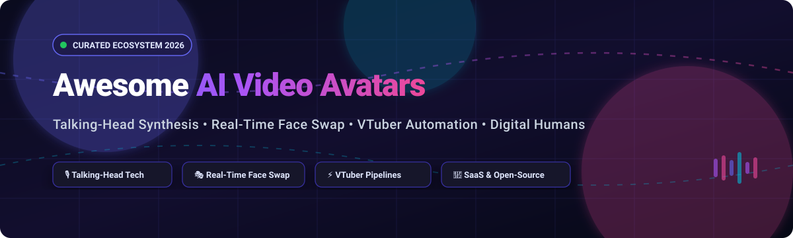

  

# 🌟 Awesome AI Video Avatars

  
  
  
  
  

## 🚀 Top AI Video Avatars Ecosystem

**Curated List of SaaS Products & Open-Source GitHub Projects**  
*Focused on Talking-Head Synthesis, Real-Time Face Swap, Digital Humans & VTuber Automation*  

**Last updated: October 2026**

Welcome to **Awesome AI Video Avatars**, the authoritative directory and curated landscape of cutting-edge **AI Video Avatars**, **Talking-Head Generation models**, **Real-Time Face Swap frameworks**, and **VTuber Automation tools**. Whether you are an AI researcher, video engineer, digital marketer, live streamer, or creator looking for enterprise SaaS solutions or fully local, self-hosted open-source pipelines, this guide tracks performance benchmarks, pricing tiers, and production capabilities.

---

## 📑 Table of Contents

- [📊 Sector Overview & Market Dynamics](#-sector-overview--market-dynamics)
- [🏢 SaaS & Hosted Commercial Platforms](#-saas--hosted-commercial-platforms)
- [💻 Open-Source GitHub Projects](#-open-source-github-projects)
- [🛠️ Frameworks for Custom AI Pipelines](#️-frameworks-for-custom-ai-pipelines)
- [🤝 How to Contribute](#-how-to-contribute)
- [💖 Support](#-support)
- [📈 Star History](#-star-history)
- [⚖️ Disclaimer & Responsible AI](#️-disclaimer--responsible-ai)

---

## 📊 Sector Overview & Market Dynamics

The global AI avatar and digital human market is estimated between **$1.1B and $6.4B in 2025–2026**, growing at a CAGR of ~30–45% as enterprise demand accelerates across corporate L&D, customer service kiosks, and personalized marketing. The sector is currently **moderately to highly fragmented** rather than winner-take-all, segmented across distinct niches such as enterprise communications, real-time conversational streaming agents, localized e-commerce live streamers, and creative entertainment.

---

## 🏢 SaaS & Hosted Commercial Platforms

| Platform | Scale (Valuation / Revenue) | Starting Pricing | Free Tier / Trial Limits | Key Features |
| :--- | :--- | :--- | :--- | :--- |
| **[Runway](https://runwayml.com/)** | Valued at **$5.3B** (~$170M–$200M ARR) | **$15/mo** (or $12/mo billed annually) for Standard | **125 one-time free credits** on sign-up (does not recur/refresh, watermarked exports) | AI video generation & editing with Gen-3/Gen-4, Act-One performance capture, and motion brush |
| **[Synthesia](https://www.synthesia.io/)** | Valued at **$4.0B** (~$140M–$150M ARR) | **$29/mo** (or $22/mo billed annually) for Starter | **Free Forever plan**: 36 mins of video/year (up to 3 mins/mo), 3 avatars, watermarked exports | 230+ avatars, 140+ languages, custom avatar creation, voice cloning, enterprise standard for L&D |
| **[HeyGen](https://www.heygen.com/)** | Valued at **$500M** ($200M ARR) | **$29/mo** (or $24/mo billed annually) for Creator | **Free Forever plan**: 1 credit/month (up to 1 min video), 720p/1080p web-link sharing, watermarked | Avatar IV expressive talking heads, video translation, personalized video at scale, interactive avatars |
| **[Pika](https://pika.art/)** | Valued at **$470M** ($135M raised) | **$10/mo** (or $8/mo billed annually) for Starter | **Free Forever plan**: Initial free credit grant (~80–120 credits for testing, non-commercial only) | AI video generation with Pikaffects for creative transformations, text-to-video, and image-to-video |
| **[D-ID](https://www.d-id.com/)** | ~$30M–$35M ARR ($65M raised) | **$5.90/mo** (or $4.70/mo billed annually) for Lite | **14-day free trial**: 5 mins of video credits total, full studio access, watermarked exports | Creative Reality Studio photo-to-avatar animation, real-time streaming digital humans, API integration |
| **[DeepBrain AI](https://www.deepbrain.io/)** | ~$12.8M ARR ($52M raised) | **$30/mo** (or $24/mo billed annually) for Starter | **Free Trial**: Limited test generation with up to 1 min preview render, watermark included | AI Studios text-to-video, realistic human avatars, AI Kiosk for interactive retail/banking avatars |
| **[Hour One](https://hourone.ai/)** | ~$10M–$11.5M ARR ($24M raised) | **$30/mo** (or $25/mo billed annually) for Lite | **Free Forever plan**: Up to 3 mins of published video total (1 seat, standard avatars, watermark) | Presenter avatars, 3D templates, text-to-video generation, custom avatar creation, brand kits |
| **[Colossyan](https://www.colossyan.com/)** | ~$6.6M ARR ($27M raised) | **$27/mo** (or $19/mo billed annually) for Starter | **Free Forever plan**: Up to 3 mins of video total, basic avatars, 15 scenes per video, watermarked | Workplace learning platform with avatars, voice cloning, auto-translation, and SCORM LMS export |
| **[Elai.io](https://elai.io/)** | ~$1.3M ARR (Bootstrapped/Seed) | **$29/mo** (or $23/mo billed annually) for Creator | **Free Forever plan**: 1 min of video render total, 1 seat, restricted slide templates, watermark | PowerPoint-to-video conversion, custom digital avatars, automated multi-language voiceovers |
| **[Rephrase.ai](https://www.rephrase.ai/)** | Acquired by **Adobe** ($14M raised) | **$25/mo** (Starter tier prior to Adobe integration) | **14-day free trial**: Up to 2 video credits for avatar test renders (now integrated into Adobe ecosystem) | Digital avatars and hyper-personalized video campaigns at scale (acqui-hired by Adobe) |

---

## 💻 Open-Source GitHub Projects

Curated open-source repositories for self-hosted digital humans, talking-head synthesis, real-time face replacement, and virtual VTuber streams. **Ranked descending by GitHub Stargazer Count.**

1. ### 🎭 [Deep-Live-Cam](https://github.com/hacksider/Deep-Live-Cam) 
   - **Real-time face swap and one-click video deepfake with a single image** — the most widely adopted open-source face swap tool.
   - **Three-click workflow**: Select face → select camera → press live.
   - **Features**: Mouth Mask (retain original mouth for accurate movement), Face Mapping (different faces on multiple subjects simultaneously), and **OBS virtual camera support** for live streaming.
   - **Model engines**: Inswapper (128x128), HyperSwap (256x256), ReSwapper, Decart Live (cloud real-time diffusion), and FLUX Live (real-time prompt-based face editing at 30fps).
   - **Pre-built binaries** for Windows (DirectML, CUDA, OpenVINO), macOS (CoreML), and Linux. *(Non-commercial license)*.

2. ### 🎥 [DeepFaceLive](https://github.com/iperov/DeepFaceLive) 
   - **Real-time face swap for PC streaming and video calls** by the creator of DeepFaceLab.
   - Low-latency inference pipeline optimized for broadcast streaming and virtual meetings via OBS and DirectShow virtual camera output.
   - Includes real-time face alignment, lighting correction, and custom neural network weights support.

3. ### 👤 [LivePortrait](https://github.com/KwaiVGI/LivePortrait) 
   - **Efficient portrait animation with stitching and retargeting control** by Kuaishou Technology.
   - Animates static portraits using driving video or audio with precise control over facial expression, eye gaze direction, head pose, and lip synchronization at high FPS.
   - Highly modular architecture serving as the backbone for numerous production pipelines and derivative open-source tools.

4. ### 🗣️ [SadTalker](https://github.com/OpenTalker/SadTalker) 
   - **Learning Realistic 3D Motion Coefficients for Stylized Audio-Driven Single Image Talking Face Animation** (CVPR 2023).
   - Generates realistic 3D motion coefficients from speech audio and drives 2D portrait photos with expressive head poses and natural blinks.
   - Native integration with Stable Diffusion WebUI and ComfyUI workflows.

5. ### 👄 [Wav2Lip](https://github.com/Rudrabha/Wav2Lip) 
   - **Accurately Lip-Syncing Videos to Any Speech in the Wild** (ACM Multimedia).
   - Foundational deep learning model for synchronizing arbitrary talking-head video clips to any target audio waveform with precise phoneme-to-viseme alignment.
   - Works across multiple languages and speech cadences.

6. ### 🔄 [Video-ReTalking](https://github.com/vinthony/video-retalking) 
   - **Audio-based Lip Synchronization and Facial Expression Editing for In-the-Wild Talking Head Video** (SIGGRAPH Asia 2022).
   - Disentangles audio-driven lip motion, facial expression generation, and face photo restoration to produce realistic talking videos from in-the-wild inputs without artifacts.

7. ### ⚡ [MuseTalk](https://github.com/TMElyralab/MuseTalk) 
   - **Real-Time High Quality Lip-Syncing with Latent Space Inpainting** by Tencent Music Entertainment.
   - Runs at 30+ fps on NVIDIA RTX 4090 GPUs; supports multi-lingual inputs and complete face region modification with low latency for interactive real-time avatars.

8. ### ⏱️ [LatentSync](https://github.com/bytedance/LatentSync) 
   - **Audio Conditioned Latent Diffusion Models for Lip Sync** by ByteDance.
   - Eliminates pixel-space blurriness by performing lip synthesis directly inside the latent space of diffusion models, yielding crisp photorealistic mouth textures and temporal stability.

9. ### 🎨 [EchoMimic](https://github.com/BadToBest/EchoMimic) 
   - **Lifelike Audio-Driven Portrait Animations through Editable Landmark Conditioning** by Ant Group.
   - Simultaneously processes speech audio and visual landmark tracks for fine-grained control over head tilting, emotional facial expressions, and natural blinking.

10. ### 🐱 [LongCat-Video-Avatar 1.5](https://github.com/meituan-longcat/LongCat-Video-Avatar) 
    - **Commercial-grade digital human video generation model** (MIT) by Meituan.
    - **Benchmark Winner**: 65.9% win rate vs Kling Avatar 2.0, 61.1% vs OmniHuman-1.5, and 54.3% vs HeyGen in blind user preference evaluations.
    - **Whisper-large audio encoder** for complex syllable cadence, **GRPO human preference alignment** for hand rendering in livestream scenarios, and **15x faster inference** via Distributed Matching Distillation (10s video in ~1 min on a single H200 GPU).

11. ### 🎙️ [AVTR-1 (Avaturn Live)](https://github.com/avaturn-live/avtr-1) 
    - **Open-source real-time avatar model** rendering lip-synced speech and active listening at 25 fps on a single GPU.
    - **Latency**: L40 (84ms/chunk, 2.4× real-time), RTX 4060 Ti (166ms, 1.2×).
    - Governed by the AVTR-1 Community License with explicit responsible AI protections against unauthorized biometric synthesis.

12. ### 🌐 [facestream](https://github.com/philipp-eisen/facestream) 
    - **WebRTC remote real-time face swap app** enabling low-spec client devices and laptops to stream real-time face swapping via serverless GPU backends (Modal) and Cloudflare TURN networking.

13. ### 🎮 [OpenVT](https://github.com/erodozer/open-vt) 
    - **Open-source 2D VTuber streaming software** built in Godot engine with native Linux support, VTube Studio asset compatibility, and alpha transparency capture for OBS.

14. ### 🪞 [Brioche Puppet](https://store.steampowered.com/app/4286130/Brioche_Puppet/)
    - **Free open-source VTuber production software** on Steam supporting MMD and VRM models, MediaPipe video tracking, VMC protocol motion receiver, Bullet Physics, and PBR rendering.

15. ### 🧪 [KuroBlob AI](https://github.com/eykicuihb/KuroBlob-AI) 
    - **Living 3D Procedural Jelly Avatar Engine** with 60+ procedural emotions, camera head roll/yaw tracking at 60 FPS, OBS Chroma Key support, and dynamic LLM emotion tagging.

16. ### 🤖 [claude-codes-influencers](https://github.com/kevinbadi/claude-codes-influencers) 
    - Automated pipeline converting raw scripts into lip-synced vertical videos (1080x1920 MP4 for TikTok/Reels/Shorts) with modular character rigging and Whisper timestamp alignment.

17. ### 🎬 [FreeVideoAI](https://github.com/333kjp/freevideoai) 
    - Digital human video studio supporting zero-shot voice cloning (VoxCPM) paired with MuseTalk / LatentSync, automated B-roll insertion, and multi-shot virtual cameras.

18. ### 🧩 [higgsfree](https://github.com/kunal12203/higgsfree) 
    - Modular AI talking-avatar pipeline combining PuLID SDXL identity preservation, Chatterbox TTS, and Sonic audio-driven facial synthesis inside Docker containers.

19. ### 🎭 [Avatar Studio](https://github.com/JagTheHero/VTuberAvatarStudio) 
    - Lightweight browser-based VTuber avatar system requiring zero GPU overhead; renders interactive lip-synced avatars directly in OBS browser sources via MediaPipe and three.js.

20. ### ☁️ [Backblaze AI Avatar Video Generator](https://github.com/backblaze-b2-samples/ai-avatar-video-generator) 
    - Full-stack template (Next.js + FastAPI + Backblaze B2) for generating talking-head videos with pluggable provider backends.

21. ### 🍎 [liveportrait-joyvasa](https://pkg.go.dev/github.com/plexusone/omniavatar-core/providers/liveportrait-joyvasa)
    - Commercial-safe talking-head generation optimized for Apple Silicon MPS (LivePortrait + JoyVASA) replacing non-commercial face libraries with clean MediaPipe architectures.

22. ### 🪄 [Enliven](https://github.com/CoCoNuT-sTuDiOs/Enliven) 
    - Commercial-safe AI avatar animation engine leveraging driving video performance transfer for natural 3D head rotations, tilts, and micro-expressions.

---

## 🛠️ Frameworks for Custom AI Pipelines

For teams building self-hosted production architectures:
- **Commercial-Grade Talking-Head Generation**: Deploy **LongCat-Video-Avatar 1.5** or **LivePortrait** paired with **MuseTalk** / **LatentSync**.
- **Real-Time Broadcast & Face Swap**: Combine **Deep-Live-Cam** or **DeepFaceLive** with OBS virtual camera routing.
- **Interactive Conversational Avatars**: Integrate **AVTR-1** for dual-stream real-time conversational agents with listening/speaking state switching.
- **Low-Overhead VTubing**: Use **OpenVT** or **Avatar Studio** for GPU-less streaming and responsive avatar animation.

---

## 🤝 How to Contribute

Contributions are welcome! To propose new SaaS platforms or open-source repositories:
1. 🍴 Fork the repository.
2. 📝 Add or edit entries in `README.md` following the existing tabular or badge format.
3. 🔗 Include official documentation links, exact pricing / free tier specs, or GitHub stargazer links.
4. 🚀 Submit a Pull Request with a clear explanation of additions.

---

## 💖 Support

If you found this curated ecosystem helpful, please consider supporting the project:
- ⭐ **Star this repository** to help others discover it!
- 🍴 **Fork and share** with colleagues and AI creators.
- ☕ **Buy me a coffee / Sponsor**: Support ongoing maintenance via the [GitHub Sponsor Dashboard](https://github.com/sponsors/ishandutta2007).

---

## 📈 Star History

---

## ⚖️ Disclaimer & Responsible AI

- This repository is a **community-curated index** for research, development, and educational evaluation.
- **Consent & Ethics**: Generating AI avatars, synthetic voices, and face swaps requires strict adherence to privacy laws (GDPR, CCPA), right of publicity, and explicit consent from all individuals involved. Never generate biometric likenesses without explicit authorization.
- **Licensing Compliance**: Certain open-source weights (such as Deep-Live-Cam base weights or non-commercial facial detection libraries) carry strict research-only licenses. Verify all licensing terms before deploying in commercial settings.
- **Transparency**: Disclose synthetic media where required by regional regulations (e.g., EU AI Act Article 50).
